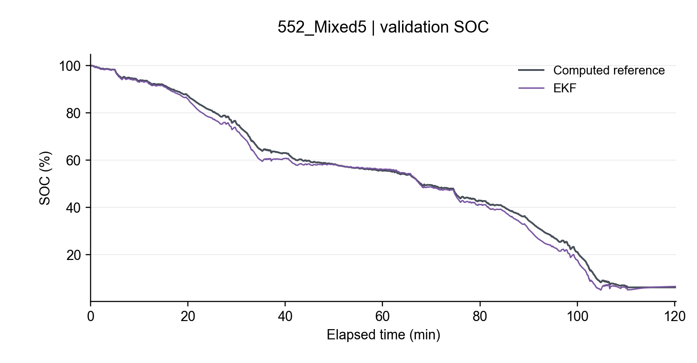
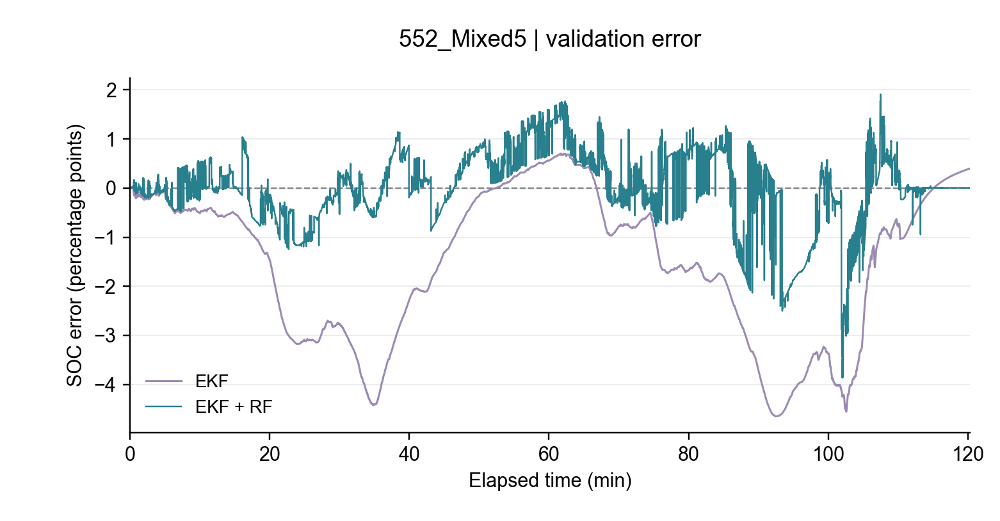
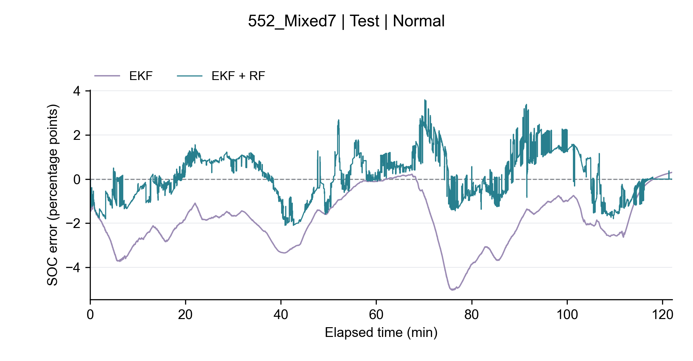

# 电池 SOC 融合估计（课程测试项目）

题目：基于扩展卡尔曼滤波与随机森林误差补偿的锂电池 SOC 估计。

## 当前进度

第一阶段数据收集和第二阶段数据准备已完成：29个原始CSV已清洗，8条动态工况已核对充电上下文、构造参考SOC，并生成一条完整训练记录的输入曲线。详见 [数据准备报告](data/reference/数据准备报告.md)、[原始清单](data/数据清单.md)及[清洗报告](data/processed/清洗报告.md)。

第三阶段一阶RC电池建模与EKF、第四阶段随机森林误差补偿已完成：使用指定低倍率数据建立近似OCV曲线，HPPC辨识参数，并在4条训练记录上训练随机森林、通过2条验证记录比较两组方案。见[建模报告](outputs/model/建模报告.md)与[补偿建模报告](outputs/correction/补偿建模报告.md)。

第五阶段最终实验已完成：固定模型在Mixed7/8上运行正常、初始SOC偏差和测量噪声三组实验。两种方法使用相同输入和计分区间，没有利用测试结果重新训练或调参。见[实验报告](outputs/experiments/实验报告.md)。第六阶段技术交付材料已整理：7页汇报PPT、6分钟讲稿与答辩、统一运行入口、完整交付ZIP及成员填写模板。真实姓名、贡献比例、个人反思和真人计时演练仍需成员完成。

## 关于本仓库

为控制体积，仓库不包含原始与清洗后的数据、8条动态工况的逐采样CSV、逐采样预测结果和交付ZIP（见 `.gitignore`）。各清单中的哈希仍指向这些文件。需要复现时，先运行 `python scripts/prepare_data.py` 下载原始数据，再按下文顺序重建；或运行 `python main.py --stage all`。指标表、报告、图表、训练好的随机森林模型和汇报材料都已包含在仓库中。

课堂展示推荐使用 [SOC融合估计_课堂展示_可编辑版.pptx](presentation/SOC融合估计_课堂展示_可编辑版.pptx)（9页），讲稿见 [6分钟讲稿与答辩](presentation/6分钟讲稿与答辩.md)。

## 交付入口

- [交付说明](交付说明.md)：文件导航、运行方式与提交前待办。
- [7页汇报PPT](presentation/SOC融合估计_6分钟汇报.pptx)、[6分钟讲稿与答辩](presentation/6分钟讲稿与答辩.md)。
- [贡献记录与个人反思模板](presentation/贡献记录与个人反思.md)：按实际工作填写，未虚构成员经历。
- 完整复现包：`delivery/SOC融合估计_完整交付.zip`，附`delivery/交付包校验.json`。
- 展示材料正式入口：`presentation/manifest.json`，绑定上游正式实验与材料哈希。

```powershell
python main.py                                # 只列步骤
python main.py --stage experiments --dry-run  # 只列最终实验命令
python main.py --stage experiments            # 使用固定模型重跑实验和图表
python main.py --stage all                    # 全流程重建，会更新各阶段产物
```

先按下文安装`requirements.txt`。分阶段支持`data`、`model`、`correction`、`experiments`，前序产物须存在。查看现有结果不必重新训练。配置仍以各阶段已有JSON为准。重新生成展示材料后，可运行`python scripts/package_delivery.py`更新交付包；只重跑实验时，需要先核对并重新整理展示材料，避免旧PPT与新指标混用。

## 数据来源

Phillip Kollmeyer, Mina Naguib, Michael Skells，*LG 18650HG2 Li-ion Battery Data*，Version 2，Mendeley Data。DOI：[10.17632/b5mj79w5w9.2](https://doi.org/10.17632/b5mj79w5w9.2)，许可 CC BY 4.0。报告与 PPT 需注明作者和来源。

- 原始文件：`data/raw/LG_HG2_25degC/`，保留原始字节与文件名。
- 上游文件目录：`source_files_manifest.json`，保留此前获取的完整来源清单。
- 原始数据入口：`data/dataset_manifest.json`，包含实际文件、固定用途、来源链接、大小、SHA-256 和校验依据。
- 清洗数据入口：`data/processed/manifest.json`，记录清洗文件与父文件哈希、列含义、质量统计和原有划分。后续算法从此清单定位清洗数据，不混用原始文件。
- 动态输入及参考SOC入口：`data/reference/manifest.json`，包含8条动态工况、规则文件、来源哈希与固定划分；后续算法读取这些动态CSV，OCV/HPPC建模仍读取清洗清单中指定的文件。
- 原始说明：`data/raw/LG_HG2_25degC/original_README.txt`。

## 固定用途

| 用途 | 文件 |
|---|---|
| 参考容量 / 核对 | 551_Cap_1C / 552_Cap_1C |
| 近似 OCV-SOC / RC 参数 | 549_C20DisCh / 549_HPPC |
| 训练 | 551_Mixed1、551_Mixed2、552_Mixed3、552_Mixed4 |
| 验证 | 552_Mixed5、552_Mixed6 |
| 最终测试 | 552_Mixed7、552_Mixed8 |
| 初始状态上下文 | 549_Charge、551_Charge1–8、552_Charge9–16 |

按完整工况划分，不随机拆分相邻采样点。测试集不用于拟合或调参。已按实际时间确认前序充电：Mixed1/2对应Charge6/7，Mixed3–8对应Charge9–14。主容量固定为551_Cap_1C的2.72639Ah；552的2.69280Ah只作核对，差异约1.23%。

## 重复下载与盘点

在项目根目录执行（已在 Windows、Python 3.11 下运行，仅需标准库）：

```powershell
python scripts/prepare_data.py
```

脚本补齐缺失文件；已有文件只校验，不覆盖。大小与 SHA-256 必须和上游清单一致，并检查必要字段及非空数据行，随后生成正式数据清单与中文盘点表。下载临时文件使用 `.csv.part` 后缀，通过校验后才改为正式文件名。

CSV 含前置实验说明、空字符和单位行。`Prog Time` 可能超过24小时，已按实际间隔解析。没有直接测得的SOC字段，当前参考值由满电初值近似、仪器累计容量和固定参考容量计算得到。

## 数据清洗

```powershell
python -m pip install -r requirements.txt
python scripts/clean_data.py
```

已在 Python 3.11、pandas 2.3.3、NumPy 2.3.5 下运行。只需重新盘点原始数据时，可运行 `python scripts/profile_raw.py`。

- 标准化 CSV：`data/processed/LG_HG2_25degC/`。
- 逐文件质量表：`data/processed/quality_summary.csv`。
- 删除明细及同一时刻冲突全部值：`data/processed/audit/`。
- 原始文件不修改；清洗脚本重新运行会更新清洗输出和清单。

`current_a` 放电为正、充电为负。使用 `time_s`、`dt_s` 计算时间；`timestamp_precision=date_only` 表示原始时间戳仅有日期。保留原始采样间隔，不平滑、不插值、不降采样。后续窗口、积分及滤波须按 `segment_id` 分段，不能跨长间断运行。

`capacity_raw_ah` 是原始计数器，`counter_reset` 标识归零；`segment_net_discharge_ah` 是各连续段内的电流积分。上述列都不是参考 SOC，不能直接当作机器学习标签；累计容量也不作为随机森林输入。

## 参考 SOC 与输入曲线

```powershell
python scripts/build_reference.py
python scripts/plot_inputs.py
```

规则与边界：`data/reference/reference_policy.json`。参考SOC采用 `1 − [Capacity(0) − Capacity(t)] / 2.72639`，按0～1保存，`soc_ref_pct`为百分数。每条工况的首个采样按满电近似；前序充电末端约4.2V/48.53mA、随后约61分钟静置支持这一假设。参考SOC不是独立测量真值，未裁剪，也未强制末端归零。少量再生充电会使起点附近参考值略超100%（最高约100.048%）。

- `data/reference/*.csv`：8条动态记录的输入、参考SOC及积分交叉检查列。
- `data/reference/charge_matches.csv`：充电匹配及源行号证据。
- `data/reference/capacity_check.csv`：主容量与第二次容量核对。
- `data/reference/reference_summary.csv`：各记录行数、末端SOC和积分差。
- [输入与参考SOC示例](outputs/figures/Mixed1_inputs_reference.png)：Mixed1全部77,226条采样，附PDF、SVG。

`soc_ref`、`soc_ref_pct`、`net_discharge_ah`和`soc_integral_check`只用于训练标签或评价，不能作为随机森林输入；累计运行时间也不作为预测特征。重跑清洗后，上游哈希变动会被参考数据脚本检查到，需重新生成参考数据与图。

## 一阶RC建模与EKF

```powershell
python scripts/build_model.py
python scripts/plot_model.py
```

已在 Python 3.11、SciPy 1.17.1 及上述数据准备依赖下运行。

- 正式入口：`outputs/model/manifest.json`，覆盖参数、配置、逐脉冲拟合、六条预测和指标；记录输入/代码哈希及验收依据。
- 电池参数：`outputs/model/battery_parameters.json`；后续用 `src.battery.BatteryModel.load(项目根目录)` 检查正式状态及参数哈希后加载。
- EKF配置：`outputs/model/ekf_config.json`；首版工程预设，没有根据动态SOC误差搜索超参数。
- 预测：`outputs/predictions/ekf/`，包含校正前电压残差、SOC裁剪前数值、SOC方差及评价误差。
- 指标：`outputs/model/ekf_metrics.csv`；图表：`outputs/figures/model/`，附独立来源清单。

固定RC参数：R0=17.907mΩ，R1=7.123mΩ，τ=8.771s，C1=1231.3F，来自42个有效放电脉冲的参数中位数。近似OCV使用低倍率放电及固定主容量，未把低倍率末端重新归零。

验证记录 Mixed5 / Mixed6 的 MAE 为1.639 / 1.420个SOC百分点，RMSE为2.150 / 1.873个SOC百分点，最大绝对误差为4.648 / 5.893个SOC百分点。从首个采样开始全程计分。参考SOC是计算基准，以上不是独立真值精度或最终测试结论。

模型使用真实时间间隔，放电电流为正；EKF只接收时间、电流、电压，参考SOC在滤波结束后才用于评价。初始SOC固定1，极化电压固定0；不跨数据间断传播。首版忽略温度、SOC与方向对RC参数的影响，部分SOC边界更新有裁剪，次数见指标表。



## 随机森林误差补偿

```powershell
python scripts/train_correction.py
python scripts/plot_correction.py
```

已在 scikit-learn 1.8.0、joblib 1.5.3 及上述依赖下运行。此步骤读取第三阶段正式EKF输出，不重新调整电池模型。

- 正式入口：`outputs/correction/manifest.json`，覆盖补偿模型、配置、候选验证指标、六条融合预测及报告，并绑定上游哈希。
- 模型：`outputs/correction/random_forest.joblib`；后续通过 `src.correction.load_forest(项目根目录)` 检查正式状态、上游和实现哈希后加载。
- 训练规则：`outputs/correction/training_config.json`。仅4条训练记录拟合，两组候选按2条验证记录的等权平均RMSE选择；没有把验证记录追加回训练。
- 对照指标：`outputs/correction/metrics.csv`；逐记录预测：`outputs/predictions/fusion/`；图表：`outputs/figures/correction/`。
- `output_clip_count`统计本阶段新增的最终输出裁剪；EKF内部状态裁剪另见第三阶段的`ekf_metrics.csv`。
- 推理接口：`src.correction.predict_corrected(测量表, EKF输出表, 随机森林)`。测量表列名见 `MEASUREMENTS`，EKF输出列名见 `EKF_COLUMNS`；推理不需要参考SOC或累计容量。

7个输入特征为EKF SOC、端电压、电流、温度、校正前电压残差、过去5秒电流样本均值、窗口首点至当前的电压变化量。时间只用于定位窗口，窗口只用当前和历史且不跨segment。训练标签为“参考SOC−EKF SOC”；融合结果限制在0~1，补偿不回灌EKF。

验证结果参与过模型选择，训练结果是训练内表现，均不作为最终测试结论。当前融合平均误差改善，但曲线有局部抖动，部分时段误差会增大。具体数值及局限见[补偿建模报告](outputs/correction/补偿建模报告.md)。



## 最终对比实验

```powershell
python scripts/run_experiments.py
python scripts/plot_experiments.py
```

上述命令已在本项目Python 3.11和requirements.txt所列依赖下运行。直接复现最终实验不需要重新训练；已有模型、正式清单和参考数据必须保留。全流程可按本README顺序依次运行数据准备、清洗、参考SOC、建模、补偿训练与最终实验脚本。

| 实验 | EKF平均RMSE | 融合平均RMSE | 相对降低 |
|---|---:|---:|---:|
| 正常工况 | 2.116 | 0.976 | 53.89% |
| 初始SOC低估10个百分点 | 2.138 | 0.990 | 53.71% |
| 测量噪声 | 2.111 | 0.962 | 54.46% |

单位为SOC百分点，RMSE先按记录计算，再对两条测试记录等权平均。正常工况平均MAE从1.770降到0.801个百分点。平均误差改善不代表每个采样点都改善；初始偏差组的融合首点仍有约4个百分点误差。

- 正式实验入口：`outputs/experiments/manifest.json`，绑定固定模型、测试数据、代码和输出哈希。
- 协议：`outputs/experiments/experiment_config.json`；三组扰动分别施加，初始偏差与加噪不叠加。
- 逐记录指标：[metrics.csv](outputs/experiments/metrics.csv)；等记录汇总：[summary.csv](outputs/experiments/summary.csv)。
- 逐采样输出：`outputs/experiments/predictions/{normal,initial_bias,measurement_noise}/`，共6条CSV，保存实际输入、噪声、参考值、EKF和融合结果以及裁剪前数值。
- 误差定位：`outputs/experiments/time_region_metrics.csv`，补充起始60秒及后续表现；主指标仍覆盖所有采样。
- 图表：`outputs/figures/experiments/`，共12张SOC/误差图，每张提供PNG、PDF和SVG。

噪声标准差为电压0.01V、电流0.05A；Mixed7/8种子为20261029/20261030。两种算法共用同一组加噪输入，参考SOC保持原始计算值。这是单次固定噪声实现，不能推断多次重复的稳定性。参考SOC并非独立实测真值，结论限于当前电芯及两条留出记录。


